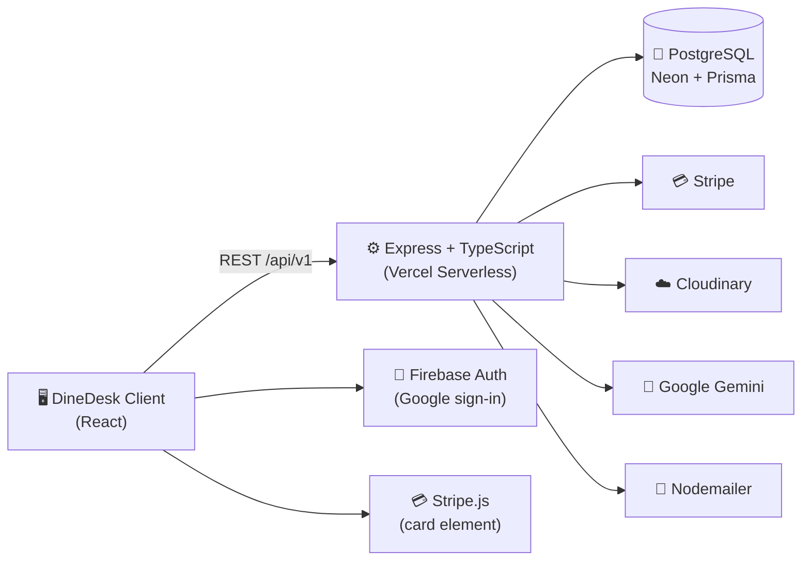
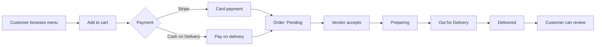
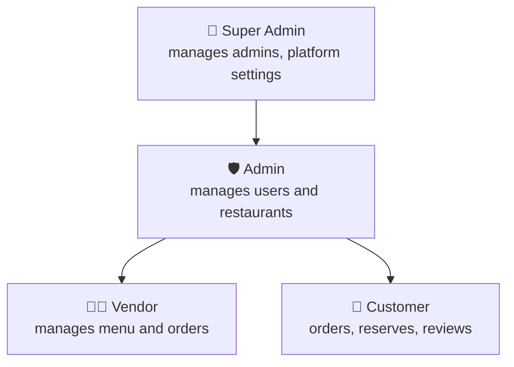

<div align="center">

# 🍽️ DineDesk

### Online Restaurant Ordering & Table Reservation Platform

<a href="#-about-the-project">
  
</a>

*Built by [DevCore Solutions](#-about-devcore-solutions), building the digital core for modern businesses.*

<br />

<table>
  <tr>
    <td align="center"><b>4</b><br/><sub>User Roles</sub></td>
    <td align="center"><b>18</b><br/><sub>Dashboard Pages</sub></td>
    <td align="center"><b>2</b><br/><sub>Payment Methods</sub></td>
    <td align="center"><b>AI</b><br/><sub>Food Assistant</sub></td>
    <td align="center"><b>Live</b><br/><sub>Order Tracking</sub></td>
    <td align="center"><b>Dark</b><br/><sub>Mode Ready</sub></td>
  </tr>
</table>

<br />

[](YOUR_LIVE_URL)
[](YOUR_CLIENT_REPO_URL)
[](https://github.com/Pinon1345/DineDesk-Backend)
[](https://dine-desk-backend.vercel.app)


[**Live Demo**](https://dine-desk-one.vercel.app/) · [**Features**](#-key-features) · [**Dashboards**](#-role-based-dashboards) · [**Get Started**](#-getting-started) · [**Report a Bug**](YOUR_CLIENT_REPO_URL/issues)

</div>

<br />

---

## 📑 Table of Contents

<details>
<summary><b>Click to expand</b></summary>

1. [About the Project](#-about-the-project)
2. [Live URL & Demo Access](#-live-url--demo-access)
3. [Key Features](#-key-features)
4. [Role-Based Dashboards](#-role-based-dashboards)
5. [A Quick Tour](#-a-quick-tour)
6. [How It Works](#-how-it-works)
7. [Tech Stack](#-tech-stack)
8. [NPM Packages Used](#-npm-packages-used)
9. [Backend Integration](#-backend-integration)
10. [Getting Started](#-getting-started)
11. [Environment Variables](#-environment-variables)
12. [Project Structure](#-project-structure)
13. [Routes Overview](#-routes-overview)
14. [Design System](#-design-system)
15. [Performance & Quality](#-performance--quality)
16. [Deployment](#-deployment)
17. [Troubleshooting](#-troubleshooting)
18. [Security](#-security)
19. [Roadmap](#-roadmap)
20. [Meet the Founders](#-meet-the-founders)
21. [About DevCore Solutions](#-about-devcore-solutions)
22. [License](#-license)

</details>

---

## 🍴 About the Project

**DineDesk** is a full-featured restaurant ordering and table-reservation platform that connects **food lovers** with **restaurants and home kitchens**. Customers browse menus, order for delivery, reserve tables and pay online. Restaurant owners list their business and run their menu and orders directly, without the heavy commissions charged by third-party delivery apps. A two-tier **Admin** and **Super Admin** system oversees the whole platform.

> This repository is the **client (frontend)**. The REST API lives in the [DineDesk-Backend repository](https://github.com/Pinon1345/DineDesk-Backend).

### 🎯 Purpose

Traditional food ordering is fragmented across phone calls and commission-heavy apps. DineDesk gives restaurants **direct access to customers** and gives customers **one secure place to order and reserve**. It also demonstrates advanced full-stack concepts:

| | |
|---|---|
| 🔐 **Multi-level RBAC** | Customer · Vendor · Admin · Super Admin |
| 💳 **Payment integration** | Stripe card payments + Cash on Delivery |
| 📡 **Live order tracking** | Status updates without a page refresh |
| 🤖 **AI assistance** | Gemini-powered dish recommendations |

---

## 🌐 Live URL & Demo Access

| | |
|---|---|
| 🌍 **Live Site** | [dine-desk-one.vercel.app](https://dine-desk-one.vercel.app/) |
| 🔌 **Live API** | [dine-desk-backend.vercel.app](https://dine-desk-backend.vercel.app) |
| 💻 **Client Repo** | [kazi-Samin/DineDesk](https://github.com/kazi-Samin/DineDesk#-role-based-dashboards) |
| ⚙️ **Server Repo** | [Pinon1345/DineDesk-Backend](https://github.com/Pinon1345/DineDesk-Backend) |

### 🔑 Demo Credentials

| Role | Email | Password |
|---|---|---|
| 🍜 Customer | `diner@dinedesk.com` | `DinerPassword123!` |
| 👨‍🍳 Vendor | `owner@dinedesk.com` | `OwnerPassword123!` |
| 🛡️ Admin | `admin@dinedesk.com` | `AdminSecurePassword123!` |
| 👑 Super Admin | `superadmin@dinedesk.com` | `SuperSecurePassword123!` |

> 💳 **Stripe test card:** `4242 4242 4242 4242` · any future expiry · any CVC · any ZIP

---

## ✨ Key Features

<table>
<tr>
<td width="50%" valign="top">

### 🛒 Customer Experience
- **Browse Restaurants**: public grid with skeleton loaders, search, filters (cuisine, price, rating, open/closed) and pagination
- **Rich Restaurant Pages**: gallery, menu grouped by category, opening hours, Google Maps embed, live Open/Closed status
- **Cart & Checkout**: persistent per-user cart, quantity stepper, promo codes, delivery / dine-in / pickup
- **Dual Payments**: Stripe card or Cash on Delivery
- **Live Order Tracking**: status stepper that updates without a refresh
- **Table Reservations**: pick date, time and party size, with email confirmation
- **Verified Reviews**: only customers with a *delivered* order can review
- **Favorites / Wishlist** for restaurants and dishes

</td>
<td width="50%" valign="top">

### 🤖 AI Assistant (Google Gemini)
- Floating chat widget that suggests dishes by **mood, craving or dietary preference**
- Answers FAQs such as delivery time and refund policy
- **Summarises a restaurant's reviews** into a short verdict
- All AI calls are made **server-side**, so no AI keys ever reach the browser

### 🔐 Authentication & Security
- Email/password and **Google login** (Firebase)
- **JWT** sessions (7-day expiry) in **HTTP-only cookies**
- **Remember Me**: persistent session or cleared on browser close
- **Forgot Password** with a secure, time-limited reset link
- Role-based route guards on top of server-side RBAC
- Reloading a private route **never** logs the user out
- Welcome email on signup

</td>
</tr>
<tr>
<td width="50%" valign="top">

### 🎨 UI / UX
- Hero slider with a clear **Order Now** call-to-action
- **Framer Motion**: fade-in hero text, staggered scroll reveals, hover scaling
- Persistent **Dark Mode**
- Responsive grids: 2 / 3 / 4 columns on mobile / tablet / desktop
- Global search, mini-cart drawer with live count, active route highlighting
- Skeleton loaders, custom 404, error boundary and toast notifications

</td>
<td width="50%" valign="top">

### 🛡️ Privacy & Compliance
- GDPR-style **cookie consent** banner (choice stored in `localStorage`)
- Dedicated **Privacy Policy** page
- Environment-variable protected configuration keys
- Footer with Terms, Privacy, newsletter signup and social links

</td>
</tr>
</table>

### 🌟 More Highlights

<table>
<tr>
<td width="33%" valign="top">

**🏠 Home Page**
- Hero slider with *Order Now*
- Featured Restaurants (latest 6, or admin-selected)
- Top Rated Restaurants (top 3)
- Food Categories grid with one-click filters
- Rotating customer-review carousel
- Floating AI assistant

</td>
<td width="33%" valign="top">

**🔎 Discovery**
- Search by name, cuisine or dish
- Filter by price, rating and open/closed
- 6–12 restaurants per page
- "Closed" badge outside operating hours
- Public, read-only preview for guests

</td>
<td width="33%" valign="top">

**💸 Checkout**
- Coupon / promo codes
- Google Maps location picker
- Saved delivery addresses
- Delivery, pickup or dine-in
- Order confirmation with estimated delivery time

</td>
</tr>
<tr>
<td width="33%" valign="top">

**⭐ Reviews**
- 1–5 star rating plus comment
- Delivered-order check before posting
- Edit and delete from the dashboard
- AI-generated review summary

</td>
<td width="33%" valign="top">

**📊 Analytics**
- Revenue and order cards
- Monthly revenue chart
- Platform growth and GMV
- Top-performing restaurants
- User-growth trends

</td>
<td width="33%" valign="top">

**⚙️ Platform Control**
- Commission percentage per order
- Featured restaurants selection
- Global maintenance mode
- Promote, demote and remove admins

</td>
</tr>
</table>

### 🧩 Feature Matrix

| Capability | Guest | Customer | Vendor | Admin | Super Admin |
|---|:---:|:---:|:---:|:---:|:---:|
| Browse restaurants and menus | ✅ | ✅ | ✅ | ✅ | ✅ |
| Add to cart, checkout, pay | ❌ | ✅ | ❌ | ❌ | ❌ |
| Reserve a table | ❌ | ✅ | ❌ | ❌ | ❌ |
| Post a review (after delivery) | ❌ | ✅ | ❌ | ❌ | ❌ |
| Manage own menu and profile | ❌ | ❌ | ✅ | ❌ | ❌ |
| Process orders and reservations | ❌ | ❌ | ✅ | ❌ | ❌ |
| Approve, publish, unpublish restaurants | ❌ | ❌ | ❌ | ✅ | ✅ |
| Manage users and roles | ❌ | ❌ | ❌ | ✅ | ✅ |
| View all transactions | ❌ | ❌ | ❌ | ✅ | ✅ |
| Manage admin accounts | ❌ | ❌ | ❌ | ❌ | ✅ |
| Platform settings and system analytics | ❌ | ❌ | ❌ | ❌ | ✅ |

---

## 🧭 Role-Based Dashboards

Four role-specific dashboards under `/dashboard`, each with its own side navigation, CRUD operations and analytics.

<table>
<tr>
<td width="25%" valign="top">

#### 🍜 Customer
`user`
- Order history with live status stepper
- Table reservations
- Profile management
- Review management
- Favorites

</td>
<td width="25%" valign="top">

#### 👨‍🍳 Vendor
`vendor`
- Incoming orders and status pipeline
- Reservation requests
- Menu CRUD with image uploads
- Restaurant profile

</td>
<td width="25%" valign="top">

#### 🛡️ Admin
`admin`
- Manage users and roles
- Approve, publish, unpublish, delete restaurants
- All transactions
- Analytics overview

</td>
<td width="25%" valign="top">

#### 👑 Super Admin
`superadmin`
- Manage admins
- Commission, featured restaurants, maintenance mode
- System-wide analytics

</td>
</tr>
</table>

---

## 🎬 A Quick Tour

Follow a single order from craving to doorstep. Click a step to expand it.

<details>
<summary><b>1️⃣ &nbsp;Discover</b>: find something delicious</summary>

<br />

Browse the public restaurant grid with no login needed. Search by name, cuisine or dish, filter by price, rating and open/closed status, or tap a **Food Category** tile on the home page. Not sure what you want? Tell the **AI assistant** your mood and it suggests dishes.

</details>

<details>
<summary><b>2️⃣ &nbsp;Order</b>: build a cart and check out</summary>

<br />

Open a restaurant, add dishes to the cart and review them in the mini-cart drawer. At checkout, apply a promo code, choose delivery, pickup or dine-in, and pay with **Stripe** or **Cash on Delivery**.

</details>

<details>
<summary><b>3️⃣ &nbsp;Track</b>: watch it happen live</summary>

<br />

Your order lands in the vendor's queue as *pending*. As the vendor moves it through **Preparing → Out for Delivery → Delivered**, the stepper on your order history updates on its own, with no refresh.

</details>

<details>
<summary><b>4️⃣ &nbsp;Reserve</b>: book a table instead</summary>

<br />

Pick a date, time and party size from any restaurant page. The vendor accepts or rejects it, and you see the result on your reservations page, with an email when it's confirmed.

</details>

<details>
<summary><b>5️⃣ &nbsp;Review</b>: share your verdict</summary>

<br />

Once an order is **delivered**, you can rate the restaurant from 1 to 5 stars and leave a comment. Only verified customers can review, so ratings stay trustworthy.

</details>

---

## 🔄 How It Works

### System Architecture



### Order Flow



### Role Hierarchy



---

## 🛠 Tech Stack

<p align="center">
  
</p>

| Layer | Technology |
|---|---|
| **Framework** | React |
| **Routing** | React Router |
| **Styling** | Tailwind CSS |
| **Animation** | Framer Motion |
| **Data Fetching** | Axios + TanStack Query |
| **Authentication** | Firebase Auth (Google) + JWT (HTTP-only cookies) |
| **Payments** | Stripe |
| **Charts** | Recharts |
| **AI** | Google Gemini (`gemini-1.5-flash`, via the API) |
| **Backend** | Node.js · Express · TypeScript · Prisma · PostgreSQL (Neon) |
| **Hosting** | YOUR_HOSTING_PROVIDER (client) · Vercel (API) |

---

## 📦 NPM Packages Used

> ⚠️ **Verify against your `package.json` before submitting.** Remove or add packages so this list matches exactly.

<details open>
<summary><b>Dependencies</b></summary>

| Package | Purpose |
|---|---|
| `react`, `react-dom` | UI library |
| `react-router-dom` | Routing and protected routes |
| `axios` | HTTP client (credentials enabled for cookie sessions) |
| `@tanstack/react-query` | Server-state fetching, caching, polling |
| `firebase` | Google OAuth |
| `@stripe/stripe-js`, `@stripe/react-stripe-js` | Stripe card payments |
| `framer-motion` | Animations |
| `recharts` | Analytics charts |
| `react-hook-form` | Form handling and validation |
| `react-hot-toast` | Toast notifications |
| `react-icons` | Icon set |
| `swiper` | Hero slider and review carousel |
| `sweetalert2` | Confirmation dialogs |
| `react-helmet-async` | Per-page document titles |

</details>

<details>
<summary><b>Dev Dependencies</b></summary>

| Package | Purpose |
|---|---|
| `vite`, `@vitejs/plugin-react` | Build tool and dev server |
| `tailwindcss`, `postcss`, `autoprefixer` | Styling pipeline |
| `eslint` | Linting |

</details>

---

## 🔌 Backend Integration

The client talks to the DineDesk API under the `/api/v1` namespace.

| Endpoint | Used for |
|---|---|
| `/api/v1/auth` | Registration, login, token refresh, logout |
| `/api/v1/restaurants` | Listings, restaurant profiles, discovery |
| `/api/v1/menus` | Menu items, categories, pricing |
| `/api/v1/bookings` | Table reservations and order tracking |
| `/api/v1/payments` | Stripe checkout sessions |
| `/api/v1/ai` | Gemini recommendations and review summaries |

- Requests are sent with credentials so the **HTTP-only session cookie** is included.
- Image uploads go through the API, which stores them on **Cloudinary**.
- The API only accepts requests from its configured `FRONTEND_URL`, so make sure your deployed client origin is set there.

---

## 🚀 Getting Started

### Prerequisites
- **Node.js** 18 or newer
- **npm**
- The [DineDesk API](https://github.com/Pinon1345/DineDesk-Backend) running locally, or use the live API

### Installation

```bash
# 1. Clone the repository
git clone YOUR_CLIENT_REPO_URL
cd dinedesk-client

# 2. Install dependencies
npm install

# 3. Set up environment variables
cp .env.example .env

# 4. Start the development server
npm run dev
```

The app runs at `http://localhost:3000`, the origin the backend's default `FRONTEND_URL` expects.

### Scripts

| Command | Description |
|---|---|
| `npm run dev` | Start the development server |
| `npm run build` | Create a production build |
| `npm run preview` | Preview the production build |
| `npm run lint` | Run ESLint |

---

## 🔑 Environment Variables

All configuration keys live in environment variables and are **never committed**. Create a `.env` file in the project root:

```env
# API
VITE_API_URL=http://localhost:5000/api/v1
# Production: https://dine-desk-backend.vercel.app/api/v1

# Firebase (client config)
VITE_FIREBASE_API_KEY=
VITE_FIREBASE_AUTH_DOMAIN=
VITE_FIREBASE_PROJECT_ID=
VITE_FIREBASE_STORAGE_BUCKET=
VITE_FIREBASE_MESSAGING_SENDER_ID=
VITE_FIREBASE_APP_ID=

# Stripe (publishable key only)
VITE_STRIPE_PUBLISHABLE_KEY=
```

> 🔒 Secrets like the database URL, JWT secret, Stripe secret key, Cloudinary secret, Firebase private key and Gemini API key belong **only** on the server.

---

## 🗂 Project Structure

> 📌 This is the intended layout. Adjust names to match your actual folders.

```
dinedesk-client/
├── public/
│   ├── favicon.svg
│   └── _redirects                  # SPA rewrite (or vercel.json / firebase.json)
├── .env.example                    # Template for environment variables
├── index.html
├── package.json
├── tailwind.config.js
├── vite.config.js
└── src/
    ├── main.jsx                    # App entry: providers + router
    ├── index.css                   # Tailwind layers, CSS variables, theme tokens
    │
    ├── assets/
    │   ├── images/                 # Hero slides, category icons, placeholders
    │   ├── icons/
    │   └── fonts/
    │
    ├── components/
    │   ├── common/                 # Reusable building blocks
    │   │   ├── Button.jsx · Modal.jsx · Badge.jsx · Rating.jsx
    │   │   ├── Pagination.jsx · SectionTitle.jsx · EmptyState.jsx
    │   │   └── ThemeToggle.jsx
    │   ├── feedback/               # Loading and error states
    │   │   ├── Spinner.jsx · PageLoader.jsx · ErrorBoundary.jsx
    │   │   └── skeletons/          # RestaurantCardSkeleton, TableSkeleton, DetailsSkeleton
    │   ├── layout/
    │   │   ├── Navbar.jsx · MobileMenu.jsx · SearchBar.jsx
    │   │   ├── Footer.jsx · Newsletter.jsx
    │   │   └── CookieConsent.jsx
    │   ├── home/                   # Hero slider, FeaturedRestaurants, TopRated,
    │   │                           # FoodCategories, CustomerReviews carousel
    │   ├── restaurant/             # RestaurantCard, FilterPanel, MenuSection,
    │   │                           # DishCard, Gallery, MapEmbed, ReviewList, ReviewForm,
    │   │                           # ReservationModal
    │   ├── cart/                   # CartDrawer, CartItem, QuantityStepper, CouponInput
    │   ├── checkout/               # AddressPicker (maps), PaymentMethod, StripeForm,
    │   │                           # OrderSummary
    │   ├── order/                  # OrderStatusStepper, OrderRow, ReservationRow
    │   ├── ai/                     # AIChatWidget, ChatMessage, SuggestionChips
    │   ├── dashboard/              # Sidebar, DashboardHeader, StatCard, DataTable,
    │   │                           # ConfirmDialog, ImageUploader
    │   └── charts/                 # RevenueChart, UserGrowthChart, TopRestaurantsChart
    │
    ├── layouts/
    │   ├── MainLayout.jsx          # Navbar + Outlet + Footer + AI widget
    │   ├── AuthLayout.jsx
    │   └── DashboardLayout.jsx     # Role-aware sidebar + content area
    │
    ├── pages/
    │   ├── Home/
    │   ├── BrowseRestaurants/
    │   ├── RestaurantDetails/
    │   ├── Cart/
    │   ├── Checkout/
    │   ├── OrderConfirmation/
    │   ├── Reserve/
    │   ├── Auth/
    │   │   ├── Login.jsx · Register.jsx · ChooseRole.jsx
    │   │   └── ForgotPassword.jsx · ResetPassword.jsx
    │   ├── Dashboard/
    │   │   ├── DashboardHome.jsx   # Profile summary + quick stats
    │   │   ├── user/               # OrderHistory, Reservations, UpdateProfile,
    │   │   │                       # Reviews, Favorites
    │   │   ├── vendor/             # Orders, Reservations, ManageMenu, ManageProfile
    │   │   ├── admin/              # ManageUsers, ManageRestaurants,
    │   │   │                       # AllTransactions, Analytics
    │   │   └── superadmin/         # ManageAdmins, PlatformSettings, SystemAnalytics
    │   └── Shared/                 # About, Contact, PrivacyPolicy, Terms, NotFound
    │
    ├── routes/
    │   ├── router.jsx              # Route definitions
    │   ├── PrivateRoute.jsx        # Requires login, waits for auth to resolve
    │   └── RoleRoute.jsx           # Restricts by role (user / vendor / admin / superadmin)
    │
    ├── providers/
    │   ├── AuthProvider.jsx        # Session, Google login, Remember Me
    │   ├── ThemeProvider.jsx       # Light / dark, persisted
    │   ├── CartProvider.jsx        # Cart state and drawer
    │   └── QueryProvider.jsx       # TanStack Query client
    │
    ├── hooks/
    │   ├── useAuth.js · useRole.js · useCart.js · useTheme.js
    │   ├── useAxiosSecure.js       # Axios with credentials + 401/403 handling
    │   ├── useDebounce.js          # Search input debouncing
    │   ├── useOrderPolling.js      # Live order status refresh
    │   └── useScrollTop.js
    │
    ├── services/                   # API layer, one file per backend resource
    │   ├── api.js                  # Axios instance (base URL from env)
    │   ├── authService.js · restaurantService.js · menuService.js
    │   ├── bookingService.js · paymentService.js · aiService.js
    │   └── adminService.js
    │
    ├── lib/
    │   ├── firebase.js             # Firebase client init
    │   ├── stripe.js               # loadStripe(publishable key)
    │   └── queryKeys.js
    │
    ├── utils/
    │   ├── formatCurrency.js · formatDate.js
    │   ├── isRestaurantOpen.js     # Open / closed from operating hours
    │   ├── calculateTotals.js      # Subtotal, coupon, delivery, total
    │   └── constants.js            # Roles, order statuses, categories
    │
    └── data/                       # Static content (categories, FAQs, footer links)
```

### 🧱 Folder Responsibilities

| Folder | Responsibility |
|---|---|
| `components/` | Presentational UI, grouped by feature so each folder can be understood in isolation |
| `pages/` | One folder per route; pages compose components and call hooks, with little logic of their own |
| `layouts/` | Shared page shells: public site, auth screens, role-aware dashboard |
| `routes/` | Route table and the guards that enforce login and role access |
| `providers/` | App-wide state (auth, theme, cart, query client) |
| `hooks/` | Reusable logic such as secure requests, polling and debouncing |
| `services/` | The only place that knows backend URLs, which keeps components free of API details |
| `lib/` | Third-party client setup (Firebase, Stripe) |
| `utils/` | Pure helper functions that are easy to test |

### 📐 Conventions

- **Components** use `PascalCase.jsx`; hooks start with `use`; utilities use `camelCase.js`
- **One responsibility per file**: pages compose, services fetch, utils compute
- **Server state** lives in TanStack Query; **client state** (theme, cart drawer) lives in context
- **Commits** are small and descriptive, for example `feat(cart): add coupon input` or `fix(auth): keep session on reload`

---

## 🗺 Routes Overview

<details>
<summary><b>Public and private routes</b></summary>

**Public:** `/` · `/restaurants` · `/restaurants/:id` · `/login` · `/register` · `/forgot-password` · `/privacy-policy`

**Private:** `/cart` · `/checkout` · `/order-confirmation/:id` · `/reserve`

</details>

<details>
<summary><b>Dashboard routes by role</b></summary>

| Role | Routes |
|---|---|
| Customer | `/dashboard/user/order-history` · `reservations` · `update-profile` · `reviews` · `favorites` |
| Vendor | `/dashboard/vendor/orders` · `reservations` · `manage-menu` · `manage-profile` |
| Admin | `/dashboard/admin/manage-users` · `manage-restaurants` · `all-transactions` · `analytics` |
| Super Admin | `/dashboard/superadmin/manage-admins` · `platform-settings` · `system-analytics` |

</details>

---

## 🎨 Design System

| | |
|---|---|
| **Palette** | YOUR_PRIMARY_COLOR (primary) · YOUR_ACCENT_COLOR (accent) · neutral slate for surfaces |
| **Typography** | YOUR_HEADING_FONT for headings · YOUR_BODY_FONT for body |
| **Themes** | Light and dark, persisted across reloads |
| **Principles** | Strong colour contrast, consistent spacing, aligned grids, food-first photography |

---

## ⚡ Performance & Quality

| | |
|---|---|
| 🦴 **Skeleton loaders** | Content-shaped placeholders instead of blank screens while data loads |
| 🗄️ **Smart caching** | TanStack Query caches responses and refetches in the background |
| 📡 **Live updates** | Order and reservation status refresh automatically through polling |
| 🎞️ **Smooth motion** | Framer Motion animations that respect reduced-motion preferences |
| 📱 **Responsive** | Mobile-first layouts tested from phones to wide desktops |
| 🌗 **Theming** | Light and dark mode persisted across reloads |
| 🧯 **Resilience** | Error boundary, custom 404 and friendly toast messages for API errors |
| 🔁 **Reload-safe** | Private routes keep the signed-in user on refresh |

---

## ☁️ Deployment

- Client hosted on **YOUR_HOSTING_PROVIDER**; API hosted on **Vercel** serverless functions
- SPA rewrite rules ensure **reloading any route never returns a 404** and never logs a signed-in user out
- The API's CORS allows only the configured `FRONTEND_URL`, so set it to the live client origin
- Production build: `npm run build`, then deploy the `dist/` folder

---

## 🛠️ Troubleshooting

| Problem | Solution |
|---|---|
| Login works but the session is lost on refresh | Make sure requests use `withCredentials: true` and the API's `FRONTEND_URL` exactly matches your client origin. |
| CORS errors in the browser | Set the API's `FRONTEND_URL` to the origin you are running on, including the port, then restart the API. |
| `404` when reloading a route in production | Add an SPA rewrite so every path serves `index.html`. |
| Stripe card form does not appear | Check `VITE_STRIPE_PUBLISHABLE_KEY` is set and starts with `pk_`. |
| Google sign-in popup fails | Add your domain under Firebase **Authentication → Settings → Authorized domains**. |
| API calls fail locally | Confirm the API is running and `VITE_API_URL` ends with `/api/v1`. |

---

## 🔒 Security

- Session tokens live in HTTP-only cookies, never in JavaScript-readable storage
- Route guards on the client, with role-based access control enforced again on the server
- Only public keys (Firebase client config, Stripe publishable key) are used in the browser
- All secrets are kept in environment variables and out of version control

If you discover a security issue, please report it privately to the DevCore Solutions team rather than opening a public issue.

---

## 🔭 Roadmap

- [x] Role-based dashboards (Customer, Vendor, Admin, Super Admin)
- [x] Stripe and Cash on Delivery checkout
- [x] AI dish recommendations
- [ ] Loyalty points and rewards
- [ ] "Popular" and "Chef's Special" badges
- [ ] Live delivery-rider tracking map
- [ ] Order and reservation email notifications

---

## 👨‍💻 Meet the Founders

DineDesk was built from the ground up by the two founders of **DevCore Solutions**.

<table>
  <tr>
    <td align="center" width="50%">
      <h3>FOURKAN BIN ILIAS</h3>
      <b>Founder · DevCore Solutions</b><br/>
      Full Stack Developer &amp; Junior Software Engineer
    </td>
    <td align="center" width="50%">
      <h3>KAZI MEHEDI HASAN</h3>
      <b>Co-Founder · DevCore Solutions</b><br/>
      Full Stack Developer &amp; Junior Software Engineer
    </td>
  </tr>
</table>

---

## 🏢 About DevCore Solutions

**DevCore Solutions** is a technology startup founded by two passionate software developers, dedicated to crafting scalable, high-performance web applications and digital solutions.

> *Building the digital core for modern businesses.*

---

## 📄 License

This project is **proprietary software** developed and maintained by **DevCore Solutions** for the DineDesk platform. All rights reserved. Unauthorized copying, distribution, or modification is prohibited.

---

<div align="center">

**© 2026 DevCore Solutions · Made by Fourkan Bin Ilias (Pinon) & Kazi Mehedi Hasan (Samin)**

</div>